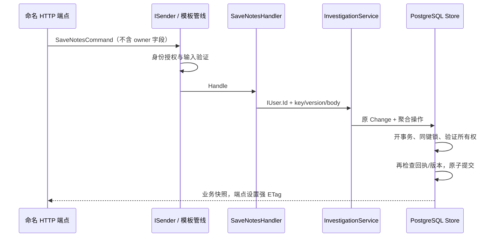

# 应用架构与责任边界

当前实现从官方 ca-sln 10.8.0 React/PostgreSQL 生成基线迁移。来源、原方案验证结果、逐文件转换及可接受偏离见 [模板来源](TEMPLATE-LINEAGE.md) 和 [ADR 0010](decisions/0010-template-first-foundation.md)。旧 ADR 0002 所述自行实现是历史，不再代表当前基础。

Domain只依赖.NET基础库；Application引用Domain，定义MediatR请求/handlers、FluentValidation验证器、模板授权等behaviors、DTO与IInvestigationStore；Infrastructure引用Application，实现EF/PostgreSQL/IdentityService；API以模板的Add*Services、CurrentUser与端点发现机制组装Scoped依赖。React通过NSwag生成的强类型端点方法访问公共API。

运行路径为HTTP→身份/CSRF→命名端点→ISender→Logging预处理→UnhandledException/Authorization/Validation/Performance→命令或查询handler→InvestigationService→IInvestigationStore→根聚合与EF→PostgreSQL。业务端点只接入ISender；原服务是handler内部复用的业务协调器，不是第二条HTTP执行路径。DbContext、Store、CurrentUser和业务服务为Scoped，TimeProvider为Singleton。模板授权行为验证请求身份，资源所有权继续由事务内的owner/id条件强制执行。

## 一致性

Store开启数据库事务，以owner/key获取事务级advisory lock；先按owner/id加载资源，再检查回执/指纹。历史同键返回原业务快照，改意图409，新键旧版本412。根方法维护规则并推进Version；根UPDATE包含原Version。子记录、审计、回执同事务；特定版本审计唯一冲突也映射412。没有外部消息副作用。

整数版本是整个调查的一致性令牌。关联修订只改既有实体，保留身份与端点；解释和修订时间成对为空/存在。可空列迁移、旧回执默认字段以及真实数据迁移测试保留。业务时间在应用边界统一到微秒。

读路径使用单语句Include取得语句级快照；每案最多6条发现、15条关联，列表限制50。OwnerId/UpdatedAt组合索引与可选实际Store查询探针属于应用数据访问；大规模分页/投影需另行需求，不以当前查询推断容量。

## 前端

App负责身份/导航；Workspace组合业务视图；useInvestigation持有已确认快照和命令；useNotesDraft持有原内容/版本/编辑代次；NotesEditor和LinkEditor管理交互。pending呈现与确认缓存分离，历史回执不倒退版本，明确冲突后才生成新意图。查询消费AbortSignal，成功响应体无法读取也保留未知写入意图。React Flow坐标是本地呈现。

`frontend/openapi.json` 来自实际ASP.NET合同；固定NSwag 14.8.0与`nswag.json`生成`src/api/generated.ts`。业务组件调用生成的登录、列表、关联修订等方法。`src/api/client.ts`仅扩展Cookie/CSRF、条件与幂等头、错误归一化及未知结果处理；类型化Action保存原操作意图。生成文件不手改，CI同时比较离线重生成和运行中API合同。

## 测试依赖

应用solution只含backend四项目。UnitTests仅引用Domain/Application；IntegrationTests引用应用API/持久化；QueryProbe是测试区域的可选查询分析工具。E2E是独立npm包，只经过UI/API，不导入应用内部模块。生产构建不需要任何测试项目。

check_boundaries.py既查源码和引用，也读取MSBuild求值Compile/ProjectReference、NuGet运行依赖、publish DLL/deps.json与前端source map来源。具体命令和边界见测试指南。它不是通用恶意构建脚本沙箱。

当前没有发布编排或集中遥测平台。请求日志、TraceId、少量业务冲突/回执计数和健康诊断保留为应用调试能力。旧环境实验见历史提交；当前CI只验应用代码。
