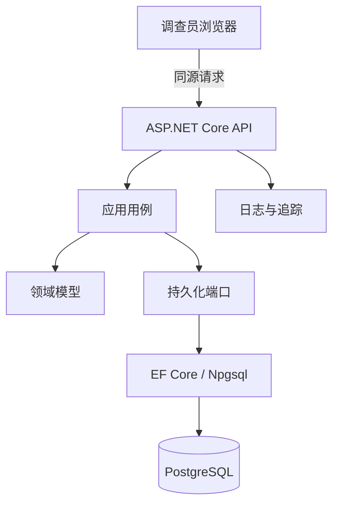

# 第 1 章 需求、边界与可证伪的架构 {#ch01}

## 从行为开始，而不是从目录开始

EchoCase 的需求不是“实现一个证据 CRUD”。调查员不能任意创建证据正文，不能在未调查两端时创建关联，不能用重复证据满足提交门槛，不能修改已封存结论。这些限制定义了一个有时间顺序、有所有权、有不可逆状态的业务流程。若先生成四层目录再补这些限制，架构很容易只剩分文件的形式。

把需求写成可观察行为，能立即改变验证方法。“系统支持并发”不可直接验收；“两个客户端基于版本 4 保存不同笔记，恰有一个成功，另一个收到 412，数据库只推进一次版本”可以验收。同样，“安全登录”过于宽泛；“没有防伪令牌的 Cookie 写请求被拒绝”是有明确威胁和观测的子目标。

| 业务模块 | 关键行为 | 不能被实现细节替代的约束 |
|---|---|---|
| 案件管理 | 浏览、开始、恢复个人调查 | 用户只能恢复自己的调查 |
| 证据管理 | 调查、解锁、持久保存发现 | 未调查的正文不出现在响应中 |
| 证据关联 | 建立、删除、图谱展示 | 两端已调查、无自环、无重复无向边 |
| 调查进度 | 笔记、复核、返回调查 | 状态和版本与子记录一致提交 |
| 结论提交 | 证据支持、固定评估、封存 | 先复核，至少三条不同的已调查证据 |

## 系统上下文与信任边界

图 1-1　一次调查操作跨越的边界。图中的 PostgreSQL 是真实依赖；浏览器路由和 API 参数都属于不可信输入。

用户界面属于体验边界，API 属于安全边界，事务属于一致性边界。三者有重合，但职责不同。禁用“进入复核”可以减少误操作，却不能防止用户直接发送 HTTP 请求。数据库外键可以阻止关联指向不存在的发现记录，却不会理解“复核中不可编辑”这样的业务语义。一个正确设计让多层防线各自承担适合它的约束，并明确它们之间的空隙。

调查聚合拥有证据发现、关联、笔记和结论。身份信息由 ASP.NET Identity 管理，案件规则在代码目录中版本化。该划分避免把密码、案件定义和一次调查都装进巨大聚合。静态目录适合单案件教学；若案件以后由编辑人员动态发布，则需要独立案件版本和审阅过程，不能在运行中修改规则后仍声称旧调查可重现。

## 为什么选择模块化单体

本项目最困难的问题是同一调查内部的正确性，不是独立团队之间的部署耦合。一个进程、一个数据库和明确的内部边界，让“发现 + 版本 + 审计 + 幂等回执”可以使用同一个本地事务。把证据与调查拆成服务，会立刻增加跨服务授权、重复投递、消息顺序和补偿问题，却没有解决当前任何已经测量的瓶颈。

模块化单体并不意味着所有类型都能互相访问。Domain 不依赖数据库；Application 定义用例与端口；Infrastructure 实现持久化；API 是组装与协议边界。这里的模块不是未来微服务的承诺，而是当前变化原因的隔离。当需求变化时，应先观察哪一层必须知道它，再决定边界是否合适。

| 方案 | 当前收益 | 当前代价 | 本项目决定 |
|---|---|---|---|
| 单文件演示 API | 很快运行 | 领域、协议和数据库难以独立测试 | 不采用 |
| 四层单体 | 可测试边界、单库事务、简单运行 | 需要维护端口和 DTO | 采用 |
| 按功能垂直切片 | 用例定位清晰 | 公共规则可能分散 | 在应用层按用例使用其思想 |
| 多服务 | 独立部署和扩展 | 分布式一致性与运维成本 | 当前需求不支持引入 |

## 质量属性必须带场景

可维护性不是抽象地“易于扩展”，而是增加一种关联规则时，领域测试应先说明新约束，应用层只负责解析命令，持久化只在模式需要变化时修改。可靠性不是“服务永不出错”，而是数据库暂停时，存活检查仍可回答，准备检查和业务请求明确失败，恢复后已提交档案仍可读取。

性能也需要范围。十万条合成时间线的索引实验只能证明特定选择率与排序条件下计划发生了变化；不能据此宣称系统支持十万并发调查员。质量属性场景应写明刺激源、环境、被刺激部分、可观察响应和测量方式，这会自然排除许多装饰性的“企业级”承诺。

## 实验 E01：边界能否阻止退化

工程问题是：一个开发者为了省事，让 Domain 直接引用 Infrastructure，门禁是否会失败？假设是，源码边界检查与运行时程序集引用检查应分别发现不同形式的越界。

先运行现有架构测试，观察 Domain 只引用系统程序集。然后在临时副本中增加向外项目引用，运行质量门禁自测。故障只注入副本，不能把主工作区改坏再忘记恢复。通过条件不是“输出一段警告”，而是坏输入的进程退出码非零，正常输入为零。

这个实验能证明已声明的依赖规则正在执行，但不能证明所有业务职责都正确。例如一个不依赖 EF 的领域类型仍可能偷偷承担展示格式化。架构门禁保护可机器识别的结构，架构评审仍要检查变化原因与语义。

## 练习与参考答案

**1-A　设计：** 若新需求是“多人协作调查”，能否只给调查增加一个共享开关？

参考答案：不能。需要定义参与人角色、加入与移除、资源权限、操作归属、并发冲突语义和审计。单一 OwnerId 的查询过滤不再充分。应先明确协作模型，再判断是否需要独立授权策略；这仍不自动要求多租户或微服务。

**1-B　评审：** 一个方案通过增加消息队列解决所有幂等问题。你会要求什么证据？

参考答案：要求说明需要跨进程异步通信的具体用例、重复投递边界、消息与数据库提交的原子性、消费者去重策略及失败恢复。队列的存在不证明恰好一次业务效果；当前单库问题可以用更小的事务方案解决。

**1-C　动手：** 在临时副本中改变依赖方向，证明门禁失败，再运行正常门禁证明恢复。记录两次退出码。只有坏输入确实失败，这项实验才闭合。
