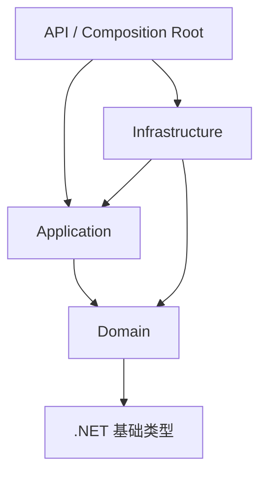

# 第 2 章 Clean Architecture 的机制与边界 {#ch02}

## 依赖倒置究竟倒置什么

依赖倒置没有消灭依赖。调查用例需要读取与保存状态，这是事实；倒置的是源代码层面对具体实现的知识。Application 声明 IInvestigationStore，Infrastructure 用 EF Core 实现它，API 在启动时把两者连接。运行时控制流仍然从应用进入数据库，编译时引用却指向应用定义的端口。

若接口原样暴露 DbSet、IQueryable 或 DbContext，那么目录上虽然有一层接口，应用仍然必须理解 EF 的跟踪、翻译和执行语义。本项目选择显式读写方法，端口返回用途明确的 SessionView；代价是需要维护一组映射，并接受这个小规模用例的专用接口。

图 2-1　这是编译依赖图，不是请求流。Infrastructure 对 Domain 的引用用于映射，Domain 不知道这些映射存在。

## 拆解上游模板而不复制答案

Jason Taylor 模板将日志、授权、校验、性能等行为放进应用请求管道。它展示了横切关注点可以围绕处理器组合，而不在每个处理器中反复编写。这个机制依赖泛型请求、开放泛型行为注册与 DI 解析顺序。把接口名称搬到新项目，不会自动获得一致的执行顺序；绕过管道直接调用处理器也会绕过这些行为。

本项目研究了模板的授权行为、校验行为、依赖注册与 SavingChanges 域事件拦截器，保留向内依赖的思路，使用显式 InvestigationService 方法表达用例。当前规模下，一个服务与少量请求记录比引入通用总线更容易追踪。需要增加多个可组合行为时，可以再评估调度器；没有使用某个库，不代表没有 CQRS，也不代表该库没有价值。

模板的授权行为能够检查角色与策略，但它无法凭空知道“某个调查只属于当前用户”。资源权限仍必须在加载调查时使用可信用户 ID 过滤。另一个容易误读的机制是 SavingChanges：在保存前分发域事件，不意味着数据库已经提交。如果处理器在此时发送外部邮件，后续保存失败，外部副作用无法由数据库回滚。EchoCase 只把审计与业务数据写进同一事务，没有宣称实现可靠的外部事件总线。

## 端口设计是一项业务选择

源码定位：[Investigations.cs](../../backend/EchoCase.Application/Investigations.cs)。

WriteAsync 接收操作上下文和对聚合的变更函数。上下文包含可信所有者、幂等键、请求指纹、目标调查、预期版本和操作名称。这样，事务、回执和并发保护由同一个基础设施实现承载，领域变更仍由应用提供。它比“每张表一个泛型仓储”更接近当前真实的原子操作。

这个端口也有明确局限：回调是进程内抽象，不能直接用于远程调用；SessionView 的生成依赖当前案件目录；一个文件容纳全部用例只适合当前数量。用例增长后，应按功能拆文件、提取共享写策略，并维持同一门禁，而不是让服务演变成包含所有领域的控制中心。

## 组装根与生命周期

DbContext、持久化端口和用例服务都是请求级 Scoped 生命周期。同一请求共享跟踪与事务边界，不会把一个线程不安全的 DbContext 作为 Singleton 跨请求使用。TimeProvider 是 Singleton，因为系统时间源没有请求状态；测试可以替换它而不修改领域规则。

将服务注册集中到组装根还有一个审查收益：可以看清运行环境到底使用真实 PostgreSQL 还是替代实现。本项目集成测试使用 WebApplicationFactory 承载 ASP.NET Core，但持久化仍是 PostgreSQL。TestServer 替代的是 HTTP 宿主传输，不是数据库隔离语义。浏览器 E2E 再补上真实网络、Cookie 与 DOM 行为。

## 不应把框架泄漏伪装成务实

依赖 EF 的领域对象当然可以工作，但必须承认这种耦合。在 EchoCase 中，实体保持私有 setter 和只读集合视图，EF 通过基础设施映射访问字段。领域不增加数据库特性标注；关系约束留在映射中。这样做让纯领域测试不需要数据库，也让数据库映射的漏洞能由集成测试单独暴露。

另一方面，也不应为了纯净而重复实现密码哈希、HTTP Cookie 或 SQL 连接池。身份验证是成熟框架擅长的技术能力，放在边界上使用框架，比把这些细节包进几十个空壳接口更清楚。抽象的价值取决于它隔离了哪一种变化，而不是接口数量。

## 实验 E02：证明结构与行为分别成立

运行 CoreHasNoFrameworkOrOutwardDependencies，确认 Domain 没有外向程序集引用，Application 没有引用 Infrastructure、EF 或 ASP.NET。接着运行领域状态转换测试，确认在不启动 API 和数据库的条件下仍可验证业务规则。这两个结果分别回答“源代码知道什么”和“业务行为是什么”，不能互相替代。

再做一次维护性评审：假设允许第三种关联类型。列出需要修改的枚举、解析、数据库 CHECK、前端选项、颜色图例和测试。若只修改领域枚举后构建仍成功，不能认为变更已完成；生成契约与数据库约束是独立的兼容边界。这项分析应产出变更清单，不虚构尚未执行的扩展实验。

## 练习与参考答案

**2-A：** 为什么不直接把 IQueryable 返回给 API？参考答案：这会把查询形状、延迟执行和数据库翻译能力扩散到外层，资源过滤可能被遗漏，事务和查询成本也难以界定。需要更自由查询时，应定义明确的投影与筛选合同。

**2-B：** 如果在领域事件处理器里写审计，是否必然与业务一起提交？参考答案：取决于触发时机、DbContext 与事务是否相同，以及处理器是否引入外部副作用。接口名与“事件驱动”标签都不提供原子性保证。

**2-C：** 找出本项目一个值得保留的具体类和一个未来可能拆分的类。参考答案：Investigation 作为单一一致性边界值得保留；InvestigationService 在用例大量增长时可以按命令/查询拆分。拆分应保留共享安全与事务策略，而不是复制它们。
