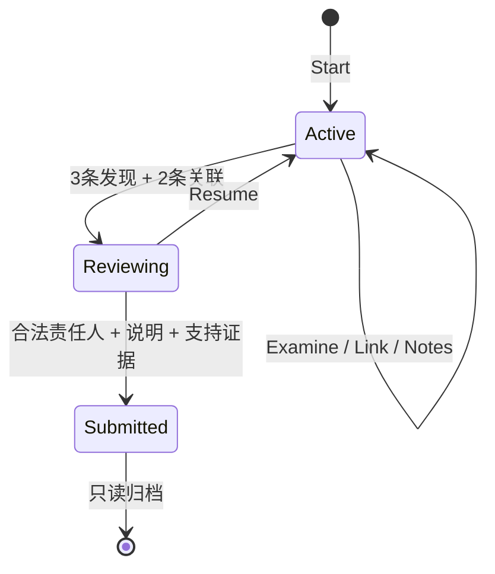

# 第 3 章 DDD、聚合与调查状态机 {#ch03}

## 领域模型的价值是缩小非法状态空间

Investigation 不是装着公共属性的数据库记录。它通过 Start、Examine、Link、Review、Resume 和 Submit 表达业务行为，只在规则满足时改变状态。外部调用者无法直接设置 Score、Status 或 Version，也不能随意往只读集合中追加发现记录。这种封装不能阻止有数据库写权限的人直接修改表，但能让应用正常路径具有可检查的语义。

不变量分为结构不变量和历史不变量。关联两端不同、版本大于零是结构不变量；只能先调查门禁再解锁凭证册、先进入复核再提交结论，是依赖操作历史的规则。数据库约束擅长保护前者；领域状态机承担后者。设计时应逐条决定规则在哪一层被拒绝，以及失败后对象是否仍保持原状态。

图 3-1　状态机没有从 Submitted 返回 Active 的边。若将来允许撤回，必须定义新的业务动作与审计含义。

## 聚合为什么包含这些子记录

结论是否可提交，依赖调查状态、发现集合和关联数量。它们必须在同一个一致性边界内判断，否则“读取三条证据→另一个操作删去关联→仍然提交”会破坏业务门槛。当前案件最多六条证据和十五对无向关联，聚合大小有明确上界，因此一次加载完整图并不构成无限增长的集合。

如果以后证据数增加到几万条，不能照搬当前全部加载的策略。可能需要独立关联聚合、预计算计数或明确的提交快照，但这会改变一致性证明。先测量聚合大小和操作竞争，再选择拆分方式；“聚合越小越好”与“所有相关数据都应在一个聚合”都过于绝对。

## 解锁规则与正文保护

案件目录定义前置证据关系。Examine 先检查状态可编辑，再检查证据存在、前置已发现和未重复调查，最后追加发现并增加版本。顺序很重要：先修改集合再检查规则，会让失败后的内存对象已经污染；即使数据库事务最终回滚，当前请求中的其他逻辑仍可能观察到坏对象。

{{code:src/EchoCase.Domain/Investigation.cs:40-49}}

响应投影把“可见摘要”和“已调查正文”分开。锁定证据返回通用摘要，未调查证据的 Body 为 null。仅在前端模糊正文、折叠卡片或用 CSS 隐藏内容，都不能提供访问控制，因为数据已经到达浏览器。这里仍然暴露了锁定证据的标题与类型，这是明确的产品选择；若要求连存在性也保密，就需要重新设计投影与解锁界面。

## 无向关联与规范化

“相互印证”与“存在矛盾”都是无向关系。领域用序数字符串比较固定两端顺序，再检查是否已有这一对证据。数据库唯一索引同样作用于调查 ID、规范化起点和终点。这样 A–B 与 B–A 不会变成两条重复边，替换关系类型也不会悄悄增加第二条互相冲突的边。

规范化只是存储策略，不是推理方向。图谱不应因为使用 React Flow 的 source/target 字段就画出因果箭头。前端已经移除箭头，保留线条和关系标签。这个例子说明：领域语言必须贯穿存储、API 和视觉表达，否则一个“只是画图”的细节也可能改变业务含义。

## 结论、评估与不可逆动作

Submit 要求复核状态、合法责任人、20–4000 字符说明和至少三条不同的已调查支持证据。说明长度只是防止空提交，不代表推理质量。确定性评分检查固定案件中的责任人与关键证据覆盖；它不是机器智能分析，也不是现实案件裁决。用相同输入得到相同结果，是当前教学模型可复现的前提。

提交后保留理由、支持证据与分数，并进入终态。若允许重复提交覆盖原结论，就会失去“这一次归档到底基于什么”的可审计性。当前选择是创建新的调查来重新尝试，而不是在同一封存档案中重写历史。

## 实验 E03：失败操作是否留下副作用

先对一个新调查尝试调查调度消息，预期得到 evidence_locked，Version 仍为 1。再调查门禁记录，预期凭证册可见，调度消息仍锁定。重复调查同一证据，预期被拒绝且版本不增加。最后完成三条发现和两条关联，进入复核，证明写笔记会失败，Resume 后可以继续。

这些测试不是对私有字段赋值后断言同一字段，而是从公开业务动作检验非法路径。更有价值的断言是“失败后没有变化”，它能发现检查与修改顺序的问题。数据库集成测试会进一步检查失败请求没有回执或审计残留，见[第 9 章](#ch09)。

## 练习与参考答案

**3-A：** 为什么重复发现不直接忽略？参考答案：业务动作和传输重试是两件事。同一幂等键重试返回原回执；换一个新键再次调查同一证据，是新的业务请求，领域明确拒绝。也可以设计为无操作成功，但必须说明版本与审计的语义。

**3-B：** 可以把评分放在前端吗？参考答案：前端可显示预览，但归档结果必须由服务端根据受控规则计算，否则用户能伪造分数。评分规则仍不应出现在浏览器可用数据中作为隐藏答案。

**3-C：** 给“复核后还可以写笔记”提出两个设计方案。参考答案：允许非证据性备注作为独立、追加式审阅记录，或者要求 Resume 后再修改调查笔记。两者的审计含义不同；不能仅删除 Editable 检查而不讨论结论快照。
