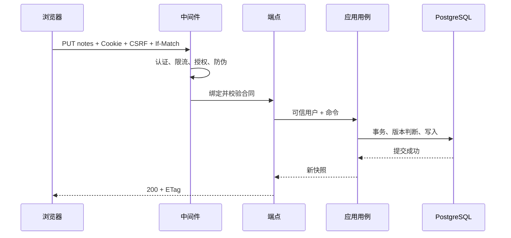

# 第 4 章 ASP.NET Core 请求管道与依赖注入 {#ch04}

## 一次请求的成功由许多层共同决定

以“保存笔记”为例，客户端发出 PUT，请求先经过 Kestrel 的大小限制，再进入安全响应头和异常映射中间件。路由确定端点元数据，认证把 Cookie 票据转成 ClaimsPrincipal，限流按用户分区，授权确认已登录，防伪校验确认写请求携带匹配令牌，最后才执行参数绑定与应用用例。任何前置步骤失败，领域代码都不应被调用。

图 4-1　协议元数据在边界被解析；Cookie 和请求头不会进入领域模型。

中间件次序是一种安全决策。按用户限流之前必须完成认证，否则所有请求可能落入 anonymous 分区；需要读取端点策略的组件应在路由之后；异常映射需要包住可能抛错的后续逻辑。把所有安全组件注册进 DI 不等于它们已在正确位置执行。

## 认证、授权和防伪并非同一检查

认证回答“请求代表谁”；端点授权回答“这个端点是否要求已登录”；资源授权回答“这个用户能否操作这份调查”；防伪校验回答“携带浏览器自动 Cookie 的写请求，是否来自持有合法请求令牌的页面”。一个请求可能通过前三项中的部分检查，仍然因为另一项失败。

ASP.NET Core 10 对已识别 API 端点的 Cookie 认证失败采用 401/403 语义。本项目也显式设置跳转事件，使 API 合同容易审查：浏览器收到登录 HTML 不应被误认为有效的 SessionView。前端不能仅根据 fetch 没有抛网络异常就认为操作成功，必须检查 HTTP 状态和响应结构。

## 作用域与请求级工作单元

每个请求有一个 DI 作用域。EchoDbContext、PostgresInvestigationStore 和 InvestigationService 都是 Scoped；注入到同一请求中的实例共享 DbContext。事务由持久化端口开启，应用服务不手工创建第二个上下文。这种约束使审计和幂等回执能与聚合一起提交。

不要把 Scoped 服务捕获进 Singleton 后台对象。即使第一次调用看起来正常，作用域结束后对象可能已释放，或后续请求并发访问同一个上下文。真正的后台任务应显式创建作用域，并重新加载它需要的状态。EchoCase 当前没有后台任务，因此也没有为了演示而引入无用的后台队列。

## 参数绑定与错误形状

请求记录使用非空构造参数，HTTP JSON 配置拒绝缺失必需参数、显式 null 和未知成员。未知成员拒绝策略能提早暴露前后端合同漂移；代价是滚动部署时不能随意让新客户端向旧服务器发送新增字段。未来若需要宽容读取，应针对具体兼容策略调整，而不是一边声称严格合同，一边静默忽略拼错的属性。

业务错误由 DomainRule 表达，映射为 422。版本冲突为 412，缺少 If-Match 为 428，幂等键复用为 409。数据库依赖不可用为 503，未知错误为 500。响应使用 Problem Details，包含稳定的机器代码和追踪编号，不把堆栈、SQL 或连接信息送到浏览器。

## 案例：为什么数据库断开曾返回 500

最初错误处理只匹配顶层 NpgsqlException。实际故障实验中，EF 的执行策略把连接失败包装成 InvalidOperationException，内层才是 NpgsqlException，于是兜底分支把它映射成 internal_error。静态阅读容易忽略异常包装，真实断库则让问题立即出现。

修正只识别已知包装形态，不把所有 InvalidOperationException 都当成临时数据库故障。后者会掩盖程序错误并鼓励无意义重试。修正后重新执行相同停库实验，确认存活为 200，准备检查与业务读取为 503，恢复后原档案仍可读取。失败与修复证据分别保存在可靠性证据目录。

## 实验 E04：观察中间件拒绝路径

从已登录客户端发送没有 X-CSRF-TOKEN 的写请求，预期 400；携带正确防伪令牌但缺少 If-Match，预期 428；携带完整头部但版本过期，预期 412。这三个结果证明请求确实到达不同保护层，而不是“任何失败都返回 400”。结合追踪编号检查日志，确认没有正文或密码被写入请求摘要。

重现时使用项目集成测试，不要把真实密码粘到终端录屏里。API 日志记录方法、路径、状态、耗时和 trace ID；身份凭证不属于普通诊断日志。若以后增加请求体日志，必须先明确字段脱敏和数据保留策略。

## 练习与参考答案

**4-A：** 为什么健康检查分 live 和 ready？参考答案：进程仍可响应与能够完成依赖数据库的工作是不同状态。数据库短暂中断时反复重启进程，可能增加连接风暴；应先让流量感知不可用，再依据故障类型恢复。

**4-B：** 所有 500 都自动重试三次会发生什么？参考答案：可能重复写入、放大数据库压力并延长故障。需要判断操作是否可安全重试、是否具有幂等键、失败是否发生于提交之后，并设置超时与预算。

**4-C：** 在开发环境和容器 HTTP 实验中观察 Cookie 的 Secure 属性，再解释生产配置为什么不同。参考答案：本地回环 HTTP 需要 SameAsRequest；生产应通过 HTTPS 并使用 Always。不能把本地配置直接发布到公网。
