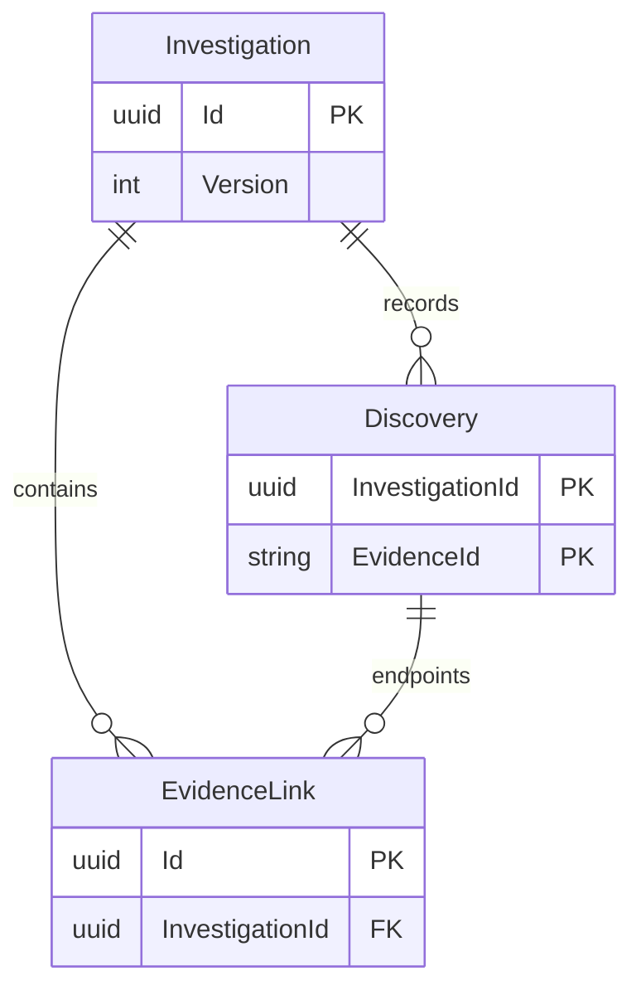

# 第 7 章 EF Core、关系设计与迁移 {#ch07}

## 关系模式表达第二道约束

领域规则不等于数据库约束。程序可能出现漏洞，迁移脚本也可能直接写表。因此 PostgreSQL 中仍保留关键 CHECK、唯一键和外键：Version 大于零；Status 位于合法集合；Submitted 与 Score 非空一致；关联不能自连；同一调查的一对证据只有一条关联；关联两端必须引用已经发现的证据。

图 7-1　调查、发现和关联的核心关系。Identity、审计与回执省略，完整映射以 EchoDbContext 为准。

审计表当前没有对调查建立数据库外键，回执通过响应快照保留原操作结果；这两项不应被图中语义连线误认为完整参照完整性。核心调查、发现和关联的外键则由数据库执行。任何架构图都需要给出这种精度说明。

## 集合映射与实体跟踪

领域返回 IReadOnlyCollection，并在内部保留字段集合；EF 映射使用 Field 访问方式。这样查询后加载的发现和关联可以被跟踪，外部应用仍只能通过聚合动作改变它们。它隔离的是普通调用路径，不是阻止反射或拥有数据库权限的操作者。

EF 需要判断一个新关联到底应该 INSERT 还是 UPDATE。最初 EvidenceLink 在构造时生成 Guid，但主键映射沿用默认生成约定。在一个已跟踪集合中加入非默认主键对象时，EF 将它误判成已有实体，UPDATE 找不到行，抛出并发异常。修正将主键设为 ValueGeneratedNever，明确 ID 来自领域。

这个缺陷说明：单元测试通过不代表 ORM 映射正确。领域中的对象集合看起来完全正常，只有真实数据库工作流才暴露实体状态推断。遇到“没有并发用户却一直并发冲突”，应检查 ChangeTracker 状态与实际 SQL，而不是立即关闭并发检查。

## 查询快照与加载策略

同时 Include 两个集合可能形成笛卡尔扩张。AsSplitQuery 能减少重复行，但在 READ COMMITTED 下多个 SQL 语句可能看到不同提交时刻；若第一条读到旧版本，第二条读到新关联，返回值就不再是同一快照。当前聚合子项数量有固定上界，选择 AsSingleQuery 换取一次语句级快照。

这不是普遍建议。大集合可以使用只读投影、拆分查询加一致性事务、单独分页或明确弱一致性语义。应同时评估数据规模、隔离级别和用户能接受的状态差异。只用查询次数判断好坏，会忽略一致性与传输重复量。

## 迁移不是重新建库

初始迁移建立 Identity 与调查表；第二次迁移增加所有者与更新时间的组合索引。升级测试先应用初始迁移，插入身份和带笔记的调查，再应用最终迁移，用新上下文验证笔记保留，并确认至少两个迁移记录存在。它验证的是增量升级路径，而不是删除数据库后重新运行初始建表。

EF 工具生成新迁移后，需要重新编译再应用。执行中曾在生成新文件后直接使用 --no-build，导致运行中的迁移程序集仍旧，触发 PendingModelChangesWarning。正确修复是构建最新迁移，而不是照搬某些模板配置去忽略该警告。警告可能揭示真实未提交模式变化，应被认真处理。

## 实验 E07：数据库能否拒绝绕过领域的坏写入

在专用测试数据库里，直接向 Links 插入一条指向未发现证据的关联，预期 PostgreSQL 返回外键错误 23503。即使 Id、调查 ID 和关系类型都合法，两端发现不存在仍必须失败。随后用正常 API 完成发现并建立关联，证明合法路径没有被约束误伤。

实验还应检查事务回滚：先插入记录，再制造唯一键冲突，退出事务后第一条插入也不应残留。不要在日常开发库中运行破坏性 SQL；本项目脚本只创建随机命名的 echocase_lab_ 数据库，并在 finally 中清理这个精确目标。

## 练习与参考答案

**7-A：** 为什么证据目录没有全部存进数据库？参考答案：当前案件由代码版本固定，适合教学复现；动态编辑需求尚不存在。缺点是不能由管理员在线发布案件，也没有旧规则版本迁移机制。若案件演化，调查必须引用不可变版本。

**7-B：** 什么情况下 AsSplitQuery 更合适？参考答案：集合很大、单语句重复行成本高，并且可以通过事务快照或业务语义接受多语句读取时。必须证明返回快照的含义，而不只是观察查询变快。

**7-C：** 给“新增结论附注”设计兼容迁移。参考答案：先增加可空字段并部署能理解它的代码，写入验证后再决定是否收紧约束；不要在旧实例仍运行时立即加入它无法满足的 NOT NULL。Azure 真实滚动升级仍需额外验证。
