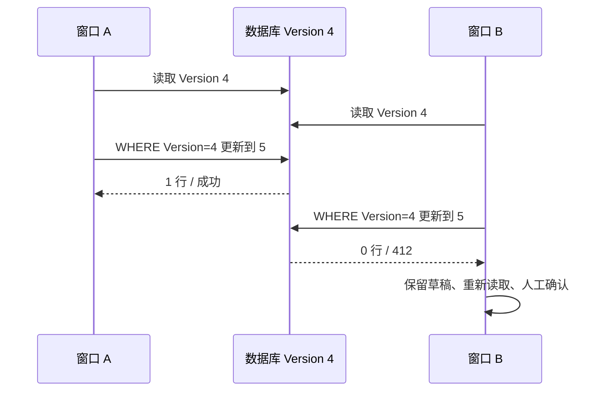

# 第 8 章 乐观并发、事务隔离与冲突解释 {#ch08}

## 丢失更新不是数据库写坏了，而是意图被覆盖

两个窗口读取值 0，各自计算加一，再依次写入 1，最终结果仍为 1。每次 SQL 都成功，数据库也忠实执行了两次赋值；被丢掉的是第二个操作之前没有看见第一个操作的事实。调查笔记的全量替换有相同风险，盲目“最后写入获胜”会覆盖用户尚未看到的内容。

版本方案让 UPDATE 带上原版本条件：只有 Version 仍为原值时才写入，并同时推进版本。第一个更新影响一行，第二个影响零行。EF Core 的并发标记把这个机制转换成 DbUpdateConcurrencyException；它不自动决定如何合并业务内容。

图 8-1　冲突是一条有价值的信息。自动换成版本 5 再提交，会重新引入覆盖用户意图的风险。

## HTTP 预检查与数据库条件缺一不可

应用先比较 If-Match 与已加载 Version，可以及时拒绝明显过期请求；但比较之后、保存之前仍有竞争窗口。数据库 UPDATE 的原版本条件才是最终防线。只在 C# 中写一个 if，不能提供原子性，因为另一个事务可以在 if 与 SaveChanges 之间提交。

集成测试有两层证据。API 并发测试使用不同幂等键、相同预期版本，要求一方 200、一方 412；另一个测试用两个独立 DbContext 读取同一实体，先保存第一方，再确认第二方抛出 EF 并发异常。后者证明数据库并发令牌在工作，而不是仅靠入口串行化碰巧通过。

## 隔离级别保护不同范围

READ COMMITTED 的每条语句看到该语句开始时已提交的数据，因此同一事务两次 SELECT 可以看到不同值。REPEATABLE READ 在 PostgreSQL 中使用稳定事务快照，重复读同一行保持一致，但它不保证任意跨行不变量都成立。SERIALIZABLE 追踪可能无法串行化的依赖，使某些事务以 40001 失败，要求应用决定是否重试。

真实实验先把值设为 10。READ COMMITTED 事务先读 10，另一个连接写成 20，再读得到 20；REPEATABLE READ 得到 10、10。接着用“两名值班员至少留一人在岗”展示写偏斜：两个事务都看到两人，分别把自己设为离岗，在 REPEATABLE READ 下可以都提交，最终无人值班；SERIALIZABLE 下第二个写事务被 40001 拒绝，保留一人。

| 机制 | 能保护什么 | 不能自动解决什么 |
|---|---|---|
| Version 条件更新 | 同一聚合的过期写 | 跨聚合不变量、业务合并 |
| REPEATABLE READ | 事务内稳定快照 | 一切跨行约束、写偏斜 |
| SERIALIZABLE | 可串行化依赖 | 重试策略、外部副作用 |
| 行锁或 advisory lock | 被锁范围的竞争 | 未遵守锁协议的其他写路径 |

## 审计顺序也会影响冲突形状

EF 可能先插入审计记录，再执行聚合 UPDATE。两个事务争夺相同下一版本时，审计的唯一索引可能先报 23505，而不是聚合 UPDATE 报并发异常。最初 API 将这一特定冲突映射为 503，导致“一胜一冲突”的测试失败。

修正仅把已知审计版本唯一约束冲突映射为 412，其他唯一约束仍保留原错误含义。事务会回滚失败者的聚合、审计和回执。不能把所有 23505 都视为可重试版本冲突，否则会掩盖重复业务键或程序缺陷。

## 实验 E08：先丢失，再保护

执行 `experiments/database.py`，观察无保护计数器最终为 1，理论无丢失应为 2；版本条件写入的影响行数为 1、0。再执行真实 EF 双上下文测试与 API 竞争测试，观察相同机制在应用中的效果。三者分别回答 SQL 原理、ORM 映射和协议行为，形成闭合证据链。

该实验是受控交错，不是随机压力测试。优点是容易解释因果，缺点是不能发现所有时序。可以在理解机制后增加重复竞争轮次，但不应把某次没有冲突当作并发保护成功，也不应无理由反复运行已经通过的全套检查。

## 练习与参考答案

**8-A：** 收到 40001 能否直接重试数据库最后一条 SQL？参考答案：通常应重试整个事务，从新快照重新读取并判断业务规则；只重试最后一句会保留过期决策。若事务含外部副作用，还需要额外去重与交付设计。

**8-B：** 为什么同一调查的子记录修改也增加根版本？参考答案：提交结论依赖整个聚合。若只更新子表而不推进根版本，旧客户端无法发现它基于的证据图已变化。

**8-C：** 一个版本冲突是否应返回双方全部笔记？参考答案：可设计成三方合并界面，但必须保留基线、当前服务端和本地草稿。当前只保留草稿并刷新快照，不声称实现自动文本合并。
