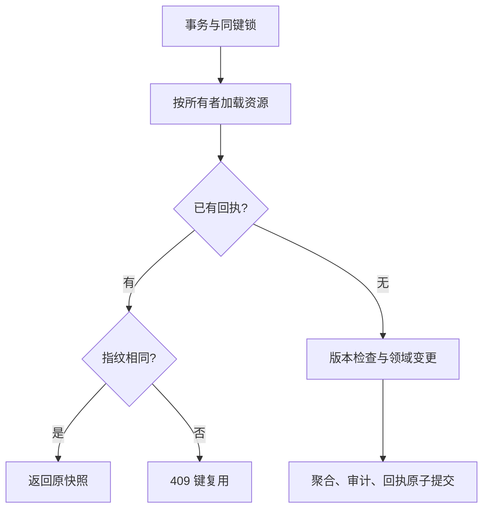

# 第 9 章 幂等、重试与提交结果不确定性 {#ch09}

## 网络失败不等于业务失败

服务端可能已经提交事务，但响应在网络中丢失。客户端看到连接错误，无法区分“请求没到达”和“提交完成但响应没回来”。如果第二次点击生成新请求，可能创建两份调查或重复提交。禁用按钮只能减少同页双击，不能覆盖超时、代理重试、多进程实例与刷新页面。

EchoCase 为一次用户意图生成 UUID 幂等键，服务端以 OwnerId 与 Key 为作用域保存回执。请求指纹包含操作名称、调查 ID、预期版本和强类型请求内容。相同键相同指纹返回原响应；相同键不同指纹返回 409。失败请求不保存成功回执。

## 键、指纹和资源权限的顺序

::: {.idempotency-diagram}

图 9-1　资源授权在回执重放之前执行，避免通过回执路径绕过所有权。相同键重放不再执行领域动作。

:::

事务级 advisory lock 由 PostgreSQL 持有，随提交或回滚释放。它根据用户与键的哈希建立竞争范围，因此同一请求在多进程中仍可串行化。哈希碰撞只会让不相关请求暂时等待，不应导致回执混淆，因为实际查询仍使用完整 OwnerId 与 Key。

这个机制要求所有写路径都遵守协议。绕过端口直接写表，不能享有其幂等保证。数据库唯一索引作为另一道防线，但单靠唯一索引不能直接返回原业务响应，也不能说明相同键是否对应相同参数。

## 原子回执比“先查再写”多了什么

{{code:src/EchoCase.Infrastructure/PostgresInvestigationStore.cs:25-48}}

若先保存业务，再在另一个事务写回执，两个事务之间崩溃会留下“业务已完成、回执不存在”的窗口，重试仍会重复执行。若先写回执，再保存业务，则可能缓存一个从未完成的成功结果。当前方案把业务、审计与回执放在同一个 PostgreSQL 事务里，缩小到数据库本身的提交边界。

同一键的两个并发请求中，第二个等待第一个释放锁，随后在 READ COMMITTED 的新语句快照中看到已提交回执。测试要求两次响应版本相同，审计中该动作只有一条。不同键的请求不互相去重；它们通过聚合版本竞争，这是另一个正确性问题。

## 原回执与最新状态有何不同

回执存储操作完成时的 SessionView。若之后已有新操作，重放得到旧版本是正常现象：它回答“原操作是否完成”，不是“现在调查是什么”。前端完成写入后重新使查询失效，读取最新快照。若将来有更复杂的并发响应顺序，应进一步按版本防止旧响应覆盖更新缓存。

当前回执没有自动清理任务，因此保证只覆盖已保留的回执。文档建议在制定重试窗口后再添加保留策略；不能删除七天前回执后仍承诺永久幂等。存储完整响应也带来空间成本，规模扩大后可以评估操作结果引用或较小回执，但必须保留足够信息回答重试。

## 客户端必须保留同一次请求

自动重试关闭是刻意的。网络中断时，工作台提供“重试同一次操作”，复用原路径、正文、版本与键。用户修改草稿后再保存，属于新意图，应使用新键。把随机 UUID 生成放在每一次底层 fetch 重试里，会使服务端幂等机制失效。

CSRF 失效也不能一概当作业务重试。需要先恢复身份与防伪上下文，再判断原请求是否可能已经提交。如果服务器已经明确返回 400 且未进入业务处理，可以重新发起；如果连接在提交时断开，仍需以原键确认。

## 实验 E09：重复、冲突与回滚

运行三个负载不同的测试：重复启动调查得到同一资源；同键改变笔记内容得到 409；同键并发保存只增加一次版本和一条审计。再让领域规则失败，确认没有缓存该键；修正业务条件或版本后可以重用这次未成功的键。

实验不会证明恰好一次网络投递。它证明的是在同数据库、保留回执、遵守端口和身份作用域的条件下，重复请求产生一次已提交业务效果。清楚限定保证，比使用“Exactly Once”标签更有工程价值。

## 练习与参考答案

**9-A：** 为什么指纹包含预期版本？参考答案：版本是用户意图所依据的状态。相同正文基于不同版本可能是重新确认后的新操作；静默把它视为原请求，会混淆确认与重试。

**9-B：** 使用进程内字典保存键有什么缺陷？参考答案：重启丢失、多实例不共享、与数据库提交不原子，且没有明确保留与容量策略。它可以用于演示，却不能替代当前持久化保证。

**9-C：** 如果代理在服务端提交后丢弃响应，如何验证恢复？参考答案：在浏览器或代理层注入响应丢失，保留同一键重发，再从数据库确认版本和审计只推进一次。必须标注注入位置，并区分原始提交证据与客户端观测。
