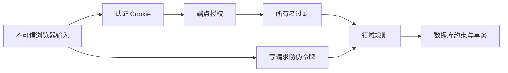

# 第 10 章 身份、资源授权与威胁建模 {#ch10}

## 先明确攻击者可以控制什么

浏览器用户可以修改请求路径、JSON、HTTP 头和本地状态，也可以跳过页面直接调用 API。攻击者不需要看到“删除”按钮才能尝试删除别人的关联；随机 UUID 增加猜测成本，但不是授权机制。另一个站点可以诱导浏览器自动携带 Cookie 发起请求，因此仅验证 Cookie 也不足以保护写操作。

本项目威胁范围包含未登录读取、水平越权、正文提前泄漏、CSRF、过期状态覆盖、重复提交、登录爆破与参数合同污染。它没有实现对恶意数据库管理员的防护，没有外部身份提供者、MFA、邮箱确认、密码重置与组织级审计保留。把这些边界写出来，是为了让当前验证可被准确理解。

图 10-1　每道防线保护不同条件。任何一个框代表的机制都不能代替其他机制。

## ASP.NET Identity 负责密码机制

EchoCase 使用 Identity 的用户管理与密码哈希，没有自创加盐算法，也不在配置中预置生产账户。注册要求唯一邮箱与至少 12 位、包含大小写和数字的密码。登录失败使用统一文案，按 IP 限流，并对已存在账户启用失败次数锁定。统一文案减少直接枚举，但当前没有证明响应时序无法区分存在与不存在的账户。

认证使用 HttpOnly Cookie，浏览器脚本无法直接读取票据；SameSite=Strict 限制跨站自动发送；生产使用 Secure Cookie。本地 HTTP 仅绑定回环地址，为教学运行采用 SameAsRequest。Cookie 过期为两小时，不滑动续期。服务端注销会清除浏览器 Cookie，但当前没有每次请求的安全戳重校验或集中会话撤销功能。

因此，在部署真实用户环境前，需要补齐账户生命周期、凭据轮换、会话吊销、身份提供者和恢复流程。这些是剩余工作，不因单机负测试通过就变成已实现能力。

## 资源授权必须靠可信身份

持久化查询同时使用 InvestigationId 和当前认证 OwnerId。找不到或不属于当前用户时统一返回 404，不向调用者确认目标是否存在。所有者从 ClaimsPrincipal 读取，JSON 不接受 OwnerId 字段。回执重放也先检查资源所有权，避免把幂等缓存变成越权捷径。

授权不只发生在 GET。建立关联、保存笔记、复核、删除关联和提交结论，都必须经过相同所有者加载路径。集成测试使用两个真实账户，验证第二个账户既不能读取，也不能修改第一个账户的调查。未来新增接口时，应把“读与写都受资源过滤”加入代码审查清单。

## 防伪令牌与同源策略

客户端先请求 `/api/auth/csrf`，服务器设置防伪 Cookie，并把请求令牌返回给同源脚本。写请求在 X-CSRF-TOKEN 头中携带它。登录后身份发生变化，客户端重新获取令牌；否则旧匿名令牌可能与当前身份不匹配。登录、注册和注销同样属于写操作，不应因为尚未进入业务模块就免除保护。

没有开放跨域 CORS。生产前端与 API 由同一容器提供，开发 Vite 使用代理保持浏览器同源。若未来拆开域名，需要重新评估凭证发送、SameSite、允许来源与防伪机制，不能用允许所有来源的配置解决开发错误。

## 输出、日志与静态资源

响应包含 nosniff、no-referrer、禁止嵌入的 CSP 等头部；脚本只允许同源，样式保留 unsafe-inline 是 React Flow 行内布局的实际需要，应在报告中说明。React 默认文本转义避免把调查笔记当 HTML；当前没有富文本编辑器，也没有使用 dangerouslySetInnerHTML 展示用户输入。

API 使用 no-store，避免个人档案被普通 HTTP 缓存保留。日志只记录请求摘要，不记录密码、Cookie、防伪令牌或笔记正文。追踪编号是诊断数据，不具有访问权限。容器重建时保留 Data Protection 密钥卷，使原认证票据可被同一应用继续解密；密钥卷的保护和备份仍属于运维责任。

## 实验 E10：负向安全路径

按顺序验证未登录 GET 返回 401、另一用户访问返回 404、带 Cookie 但缺防伪头的写请求返回 400、未知 JSON 成员被拒绝、未调查正文不出现在响应、连续无效登录最终被 429 阻断。每项检查都有独立断言，不能只用一次“登录成功”覆盖整个安全结论。

依赖扫描结果是另一个范围：当前 NuGet 和前端 npm 扫描没有报告已知漏洞，不等于没有零日漏洞、运行时漏洞或配置问题。首次 shadcn CLI 带来开发工具链漏洞；将不需要随应用保留的 CLI 移除，保留官方组件、所需 CSS 和 MIT 许可证后再扫描。没有使用强制降级去换取表面无告警。

## 会话撤销与身份生命周期的缺口

Cookie 票据通过密码学保护，并不表示服务器每次请求都重新确认账户状态。当前登录成功后，票据在有效期内代表相同用户；注销清理当前浏览器 Cookie，不会自动让被复制的旧票据在服务端失效。数据库密码修改、管理员禁用账户和所有设备退出，需要额外的票据验证或服务端会话模型。

| 方案 | 能力 | 代价 |
|---|---|---|
| 固定期限票据 | 简单、请求无需额外会话查询 | 无法立即集中撤销 |
| 定期安全戳校验 | 在校验间隔内发现账户变化 | 有撤销延迟与数据库读取 |
| 服务端会话记录 | 可按会话撤销和列出设备 | 增加状态、清理和可用性依赖 |
| 外部身份提供者 | 统一身份生命周期 | 本地资源授权和会话边界仍需设计 |

这些方案不应通过无条件每次查询数据库来草率叠加，否则数据库故障可能连进程存活检查都一起拖入失败。应先定义撤销时效，再决定校验频率、缓存与健康路由行为。当前实现没有这些能力，安全验收只覆盖已列出的认证与资源边界。

登录统一错误文案也不证明没有账户存在性侧信道。已存在用户需要执行密码哈希验证，未知用户可能更快失败；严格对抗枚举的方案还要控制时序、限流、锁定滥用与恢复流程。这里没有测量时序分布，因此把它列为未验证风险，而不是用统一文案替代证据。

## 练习与参考答案

**10-A：** 为什么防伪令牌不放 localStorage？参考答案：请求令牌可由内存持有并按身份刷新；localStorage 既不提供保密性，也增加跨会话陈旧状态。HttpOnly 保护的是认证 Cookie，不能以此推断所有脚本可读数据都安全。

**10-B：** 404 是否完全解决资源枚举？参考答案：它减少直接信息泄漏，但时序、列表接口、日志和其他侧信道仍需评估。当前测试只证明状态和资源过滤，不声称消除全部侧信道。

**10-C：** 将系统接入外部 OIDC 提供者前需要哪些决定？参考答案：可信发行者、回调与登出、主体映射、账户恢复、令牌存储和资源所有权迁移。继续保留调查资源授权；身份提供者不会自动知道 EchoCase 的所有权规则。
