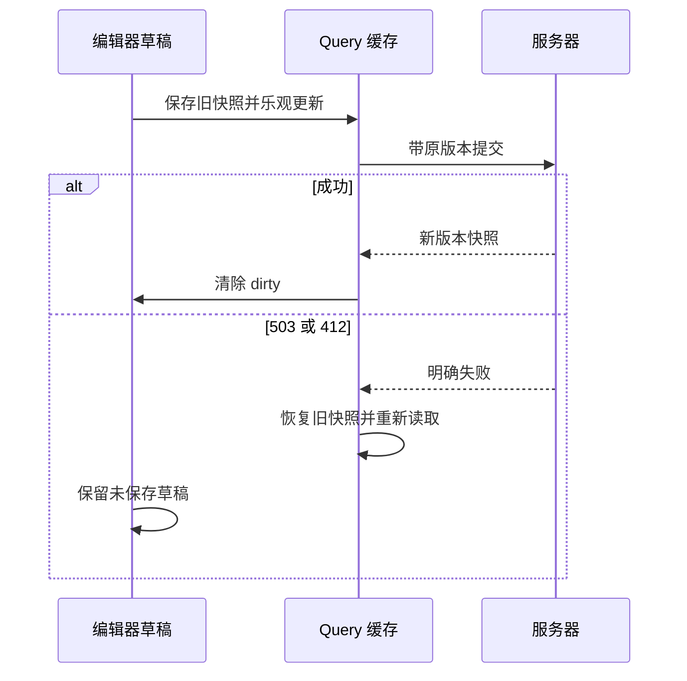

# 第 12 章 TanStack Query、乐观更新与冲突恢复 {#ch12}

## 服务端状态的困难是时间，不只是位置

缓存中的 SessionView 是某次读取的快照。服务器可能已经变化，另一个窗口可能正在提交，当前窗口也可能有未保存草稿。把服务端快照复制进本地 useState，再让两者互相同步，常会产生看似随机的覆盖。设计前先明确每次同步发生的条件。

Query Key 包含资源种类、用户 ID 和调查 ID。用户 ID 不是后端授权凭据，但能防止不同账户的本地查询碰撞。工作台配置焦点刷新和定时读取，使其他窗口的已提交变化可以被看见；这些刷新不能覆盖 dirty 草稿。

## 乐观更新不是提前宣布成功

笔记保存时，onMutate 先取消当前查询，再保存旧快照，并在缓存中放入预期笔记。onError 恢复旧缓存；本地编辑器仍保留用户输入。onSuccess 采用服务器返回的版本和快照，清除 dirty；onSettled 使调查与列表失效，重新读取当前状态。

{{code:frontend/src/App.tsx:527-560}}

取消查询是为了避免较早发出的 GET 在乐观更新之后返回并覆盖缓存。它不取消其他客户端，也不让写请求获得独占权。版本冲突仍由服务器判断。由于当前只对笔记采用乐观更新，解锁证据和封存结论必须等待服务端确认；不同业务动作可以选择不同反馈策略。

图 12-1　缓存回滚与草稿保留同时成立。回滚不是把用户刚输入的文字删掉。

## 412 的正确恢复方式

两个窗口都基于版本 1 编辑。A 先保存，B 收到 412。B 应看到服务端已变化的提示，草稿保留，重新读取后由用户确认是否提交它。自动把 B 的请求版本改为 2 再发送，会把“检测到冲突”变成“自动覆盖 A”，失去条件写入的意义。

当前工作台采用保留草稿与刷新快照的简单方案，未提供三方差异合并界面。重新点击保存代表用户基于新的服务端状态再次确认，但 UI 尚未展示完整差异，因此这是已披露的产品改进点。对长文档协作，单靠一个告警通常不够。

## 网络未知结果与明确失败

明确的 422 或 412 表示该请求没有成功提交，客户端应修正业务条件或重新确认。网络异常可能没有收到任何响应，结果不确定；界面允许复用 mutation.variables 中的原请求重试。这保留同一幂等键与版本，不会生成另一个启动或保存动作。

查询默认允许一次自动重试，写 mutation 默认不自动重试。读写风险不同，不应把同一个 retry=3 应用到所有请求。用户看到的“加载失败”和“保存结果未知”也应使用不同文案，因为后者需要保护原意图。

## 实验 E12：把乐观失败做成可复现操作

Playwright 拦截 notes 写请求，返回带标记的 503。输入新草稿并保存，预期出现注入提示，编辑器仍保持草稿。随后绕过页面缓存直接请求服务器，预期数据库笔记仍为空。解除拦截，再次保存，预期成功。这项实验同时检验 UI、缓存和服务器事实，避免只看输入框还在就误判回滚成功。

双窗口测试则不用伪造 412：两个真实页面共享登录上下文，读取同一调查，A 成功保存后 B 用旧版本写入。断言 B 收到冲突且保留草稿，服务器仍为 A 内容。它补上了浏览器缓存与真实数据库并发的联动证据。

## 练习与参考答案

**12-A：** 为什么 dirty 草稿不能随着每次 refetch 自动更新？参考答案：草稿属于用户尚未提交的意图，后台快照刷新不应静默删除它。只有保存成功、明确放弃或有清晰合并流程时才替换。

**12-B：** invalidateQueries 是否立即保证页面读到最新？参考答案：它标记失效并触发符合条件的读取，仍存在网络、调度和并发时序。正确性不能依赖它即时完成；关键写入仍需版本条件。

**12-C：** 如何避免旧幂等回执覆盖更晚版本的缓存？参考答案：比较响应与缓存版本，较旧响应只用于确认原操作完成，再读取最新状态。当前简单顺序下通过重新失效读取恢复，复杂并发场景应增加显式版本单调性保护。
