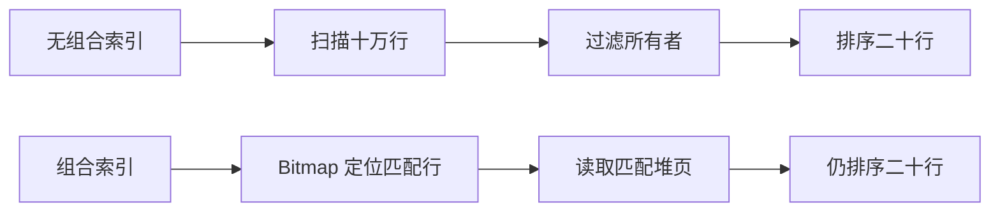

# 第 15 章 SQL 执行计划、测量与性能回归 {#ch15}

## 先问查询需要什么，再问索引建在哪里

个人调查列表按 OwnerId 过滤，再按 UpdatedAt 倒序取最近 50 条。只有 OwnerId 的索引能帮助过滤，却未必避免排序；只有 UpdatedAt 的索引可能必须跳过大量不属于该用户的行。组合索引把相等过滤与所需排序放在同一个访问路径中，正好对应当前查询形状。

性能实验建立十万条合成时间线，分布到五千个所有者，每行带固定长度负载。查询一个所有者，匹配二十行，按更新时间倒序取最多五十行。先无组合索引测量，再创建 `(owner_id, updated_at desc)`，执行 ANALYZE 后用相同 SQL 复测。数据规模与选择率公开，避免把不可比较的两次查询拼成优化故事。

## 如何读 EXPLAIN ANALYZE

EXPLAIN 给出计划器估计，ANALYZE 真正执行语句并记录实际观察。对写语句使用 EXPLAIN ANALYZE 会产生写入，不能在生产库随意运行。这里是专用合成只读查询，脚本保存 JSON 计划，便于程序检查 Seq Scan 与 Index 路径。

计划中的 cost 不是毫秒；actual time 是节点执行时间范围；rows 与 loops 需要结合读取；Buffers 帮助区分缓存命中与读取。一次看到 Index Scan 不代表总是更快：当结果覆盖大部分表时，顺序扫描可能更合理。索引还增加写放大、存储和维护成本。



图 15-1　本次计划减少访问范围，仍保留排序。查询结果没有改变。

## 实际计划为什么没有消除排序

下面是从本次 EXPLAIN JSON 自动提取的节点树，rows 与 loops 也是原始观测。索引前：

```text
{{claim:before_plan}}
```

索引后：

```text
{{claim:after_plan}}
```

计划器没有选择按 B-tree 顺序逐条返回，而是先用 Bitmap Index Scan 找出位置，再用 Bitmap Heap Scan 访问匹配堆页，最后排序。位图访问通常按页组织工作，不保留原索引的有序输出；因此“组合索引支持这个排序”与“当前计划实际省掉了排序”是两种不同陈述。

本次执行计划的共享命中块由 {{claim:before_blocks}} 变为 {{claim:after_blocks}}。对应单次 EXPLAIN 执行时间分别为 {{claim:before_execution}} / {{claim:after_execution}} ms；它们不是下表二十一次客户端样本的中位数。当前匹配行少且散布在堆页中，计划器的成本模型选择了位图加小排序。不要为了得到期望图形强制关闭顺序扫描或位图扫描，再把结果称为默认计划优化。

## 测量设计与实际结果

每个条件先预热三次，再记录二十一次端到端查询样本。中位数对少量离群值较稳健，p95 表达尾部；当前样本不足以做严格容量推断。网络、WSL、同时运行的构建与页面渲染都会影响端到端数字，因此同时保留数据库计划与所有样本。

| 条件 | 返回行数 | 端到端中位数 |
|---|---:|---:|
| 无组合索引 | 20 | {{claim:sql_before}} ms |
| 有组合索引 | 20 | {{claim:sql_after}} ms |

这组数字来自当前笔记本上的暖缓存合成表。它支持“在本次选择率与排序下，组合索引改变访问路径并降低测得延迟”，不支持“应用生产速度提升固定倍数”。真实应用增加相应迁移，并由数据保留测试验证升级，但没有用合成表的结果冒充完整 API 的优化对照。

## API 测量是另一层证据

可靠性脚本对真实 HTTP 调查读取先预热五次，再顺序请求一百次，并验证每次状态为 200、追踪上下文可传播。当前 p95 为 {{claim:api_p95}} ms。并发度为 1，因此这个值反映本机单请求路径的观察，不是最大吞吐、长时间稳定性或多用户尾延迟。

若要做负载测试，需要先定义到达率、并发模型、用户数据分布、持续时间、饱和指标和成功条件。闭环客户端会随着服务变慢而降低发压速率，可能隐藏真实排队；开环模型则要注意客户端自身是否成为瓶颈。本项目没有把短时串行测量称为企业级压测。

## 性能回归门禁如何避免噪声

当前 QA 对记录样本使用宽松的教学上限，并用故意超限输入证明检查确实失败。它证明门禁能识别被声明的性能条件，不代表这个阈值适合所有机器。CI 执行正确性测试与构建，保留本机性能证据；没有把不同硬件上的 p95 直接做严格同比。

更成熟的回归方案可以在受控硬件上比较同一数据集与同一负载，报告置信区间，并按关键路径设置预算。优化应同时观察 CPU、分配、数据库等待和错误率；单纯降低平均响应时间，可能把代价转移到失败率或内存。

## 实验 E15：计划变化能否解释时间变化

执行 database.py，保存前后 JSON 计划和样本。先只看计划预测哪种工作减少，再看测量是否一致。若时间没有改善，检查选择率、缓存、网络与采样噪声，不要强行改写结论。脚本要求两次返回行数一致，优化后计划确实使用索引路径，并在 finally 删除专用数据库。

进一步练习可以改变所有者数量，观察低选择率与高选择率时计划选择；这属于读者扩展实验，当前证据只覆盖已记录的五千所有者条件。不要把尚未执行的曲线画成测量结果。

## 练习与参考答案

**15-A：** 为什么组合索引顺序不能随便反过来？参考答案：前导列决定可以有效缩小的范围，等值 OwnerId 后跟排序时间，适合当前个人时间线。反向排列可能更适合全站时间流，但不是当前查询。

**15-B：** 加索引后写入变慢是否意味着优化失败？参考答案：需要结合读写比例与目标场景。索引维护是实际代价，若读延迟改善换来不可接受的写入或存储成本，应重新评估。

**15-C：** p95 26 ms 是否意味着 95% 的生产请求低于 26 ms？参考答案：不是。它只描述这次单机、暖机、串行、百次读取样本的经验分位，不能外推到其他负载和环境。
