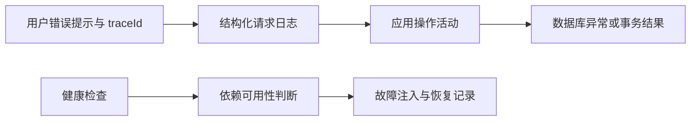

# 第 16 章 可观测性、依赖故障与恢复 {#ch16}

## 可观测性从可回答的问题开始

当用户说“刚才保存失败”，需要区分未登录、CSRF、版本冲突、领域拒绝、数据库中断与未知程序错误。日志记录方法、路径、状态、耗时与 trace ID，Problem Details 把同一追踪编号返回给用户。这样可以从一次可见失败找到服务端记录，而不要求用户提供密码或完整请求体。

应用使用 ActivitySource 标记调查写操作，Meter 声明冲突与幂等重放计数器。当前没有部署完整 OpenTelemetry collector、指标看板或告警平台，因此只能声称代码具有这些仪表点和日志关联能力，不能声称已建立生产监控闭环。traceparent 传播则由真实 HTTP 实验验证。

图 16-1　当前可观测链路。长期存储、告警路由和多实例聚合仍属于后续设计。

## 存活与准备状态必须分离

`/health/live` 只证明进程能响应；`/health/ready` 实际连接数据库。停库后，进程仍应存活，准备检查应失败，业务读取应返回 503。若把“数据库不可用”误判为“进程需要重启”，重启风暴可能增加恢复压力。

当前准备检查验证连接，不保证迁移版本完全正确，也不检查所有业务表可用性。部署流程先执行迁移再启动应用，弥补其中一部分风险；生产仍可以增加轻量模式检查或启动门禁。健康检查应快速、有界且不制造昂贵负载。

## 真正停止依赖，与浏览器返回假错误不同

浏览器回滚实验通过请求拦截返回 503，适合验证 UI 恢复；真实可靠性实验停止本项目 PostgreSQL 容器，验证连接池、异常包装、健康检查和恢复路径。前者无法证明数据库驱动错误处理，后者也不能单独证明编辑器保留草稿。两个实验覆盖不同边界。

脚本用 finally 启动被停止的容器，并轮询准备状态。它不停止其他容器，不删除数据库卷。故障窗口有界；如果恢复检查失败，脚本非零退出并留下明确错误。故障注入的可恢复性本身也属于实验设计。

## 实测结果与时间口径

| 观察 | 实际结果 |
|---|---|
| 数据库暂停后的 live | 200 |
| 数据库暂停后的 ready | 503 |
| 读取已有调查 | 503 |
| 启动命令返回后准备检查恢复 | 约 {{claim:recovery_ms}} ms |
| 恢复后原调查 | 可读取，ID 与保存前一致 |

“启动命令返回后”的计时不包含完整容器启动命令耗时，也不包含故障开始到检测的全部时间，因此不能当作系统 RTO。实验也没有执行跨主机备份恢复，不能给出生产 RPO。对时间口径的诚实解释，比一个很小的恢复数字更重要。

首次断库返回 500 的原因见[第 4 章](#ch04)：EF 包装底层连接异常，原匹配漏掉它。修正后用相同故障再运行，结果符合上表。故障恢复后读取原调查，证明既有提交未因为进程重连而消失；它不证明故障期间的未知写结果，应另以幂等键确认。

## 重试预算与故障放大

没有引入自动无限重试。数据库连接池会重建失效连接，但业务写入仍遵循显式幂等协议。若在每层都配置三次重试，一个请求可能放大成多倍数据库访问；在依赖最脆弱时制造更大压力。生产方案应设定总超时、重试次数、退避、抖动和可重试条件，并观察真实恢复效果。

当前限流是进程内分区，在多实例中不会形成共享总额度。当前日志是本地输出，没有不可篡改审计存储。当前审计与业务同库，能支持操作追踪，却不能防止拥有数据库写权限者修改历史。这些限制不会因“observability”标签而消失。

## 实验 E16：从症状到机制的排障

执行 reliability.py 前确认开发 API 可用、没有其他实验正在使用数据库。脚本先采集正常读取样本，再暂停依赖，核对三个状态，最后恢复并读取原调查。保存 JSON 结果、失败前日志和修复说明，按“症状→证据→假设→修正→重复实验”写一页复盘。

不要因为最终准备状态恢复，就删除失败记录。失败记录解释了错误映射为何需要改变，也提供未来回归时的已知症状。清理指的是恢复故障环境，不是抹去工程历史。

## 练习与参考答案

**16-A：** 数据库已经恢复，为什么还有短暂 503？参考答案：连接池旧连接、启动恢复、DNS/网络、事务取消与应用重试节奏都可能影响观察。应检查具体异常与时间线，不直接增加无限重试。

**16-B：** trace ID 为什么不能包含邮箱？参考答案：追踪编号应作为非语义关联标识，避免把个人信息扩散到日志、代理和监控。身份可以通过受控字段另行关联，并遵守保留策略。

**16-C：** 设计真正 RTO/RPO 实验需要什么？参考答案：定义故障起点、检测与恢复终点，持续记录已确认写入序列，使用独立备份介质或复制目标恢复，再比较恢复数据。当前容器重启实验不能替代这些步骤。
