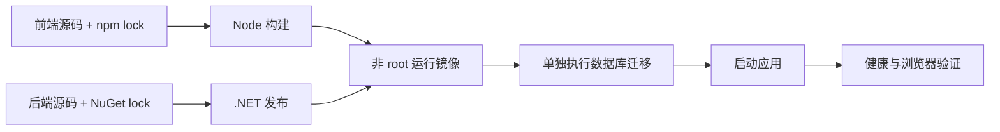

# 第 17 章 容器、CI 与 Azure 部署边界 {#ch17}

## 一份可运行镜像包含哪些东西

多阶段 Dockerfile 先用固定 Node 镜像执行 npm ci 与前端构建，再用固定 .NET SDK 镜像按锁文件还原与发布，最终只保留 ASP.NET Runtime、发布输出和前端静态资源。运行阶段使用镜像提供的非 root UID，监听 8080。前端与 API 同源，避免为部署方便引入宽松 CORS。

依赖锁文件保证包解析结果，固定基础镜像标签缩小版本漂移，但标签仍可能重新指向不同镜像。完整供应链固定需要解析并维护 digest，结合漏洞扫描、更新与来源证明。本项目记录实际构建 image ID，没有声称已经建立签名、SBOM 或位级可复现构建。

图 17-1　迁移是显式步骤，不让每个应用副本在启动时同时争抢模式升级。

## 重建与持久状态

应用容器应可删除重建，数据库卷与 Data Protection 密钥卷则独立保留。容器实验使用独立 PostgreSQL 实例，从空模式运行迁移，注册账户、创建调查，再删除并重建应用容器。随后使用原 Cookie 读取原调查，检验数据库与密钥的持久边界。

这里验证的是同机容器重建，不是异机灾难恢复。数据库卷仍与机器处于同一故障域；密钥卷没有加密备份或轮换演练。部署说明明确保留卷的停止命令，删除卷需要由所有者确认数据不再需要。

## CI 应执行什么

GitHub Actions 使用真实 PostgreSQL service，运行锁定还原、后端测试、前端生成合同、类型与构建、浏览器测试和证据门禁。构建门禁不应通过路径过滤悄悄跳过关键检查；失败后后续依赖步骤应停止，测试和日志尽可能上传为制品。

本机执行与远程 Actions 是两种证据。验收报告记录实际远程运行状态；工作流文件存在不算已验证。若远程基础设施或权限导致阻塞，应保留运行链接和失败原因，不把本地全绿改写成远程成功。

## 本地重建实验的限制

Podman 初始开发数据库采用 pasta 网络，不能直接接入桥接网络。首次容器实验暴露了脚本对 inspect 输出的假设。修正创建独立桥接网络和独立容器数据库，避免依赖已经配置好的开发模式。这比临时改动共享容器网络更利于验证干净环境。

本地 Compose 描述提供同样的服务关系：数据库就绪、迁移完成、应用启动。实际验收分别标注命令路径；直接 Podman 验证不能自动证明任意版本 Compose provider 都兼容。平台差异应记录，而不是把“都是 OCI”当成所有编排行为一致的证据。

## Azure 是部署设计，不是本机验证的延伸

可选择 Azure App Service 运行一个容器，配 PostgreSQL Flexible Server。部署前需要确定订阅预算、区域、网络连接、HTTPS、AllowedHosts、迁移身份、运行身份、密钥保护、日志去向和备份恢复。官方自定义容器文档说明端口和镜像配置；托管身份可用于适当的资源访问，但仍需给数据库身份授予精确权限。

本项目不执行资源创建、不设置付费套餐、不产生云费用。Azure 的网络、托管身份、生产 Cookie、伸缩与备份恢复均为 NOT_RUN。实际部署应由所有者在审阅具体资源清单与费用后批准，而不是运行一个带默认付费选项的“一键上线”脚本。

| 关注点 | 本地已验证 | Azure 仍需验证 |
|---|---|---|
| 进程与静态资源 | OCI 容器运行 | 平台端口、启动与探针配置 |
| 数据库 | PostgreSQL 17.7 | 网络、TLS、身份、容量与备份 |
| Cookie | 本地 HTTP 与密钥保留 | HTTPS、代理头、持久密钥保护 |
| 迁移 | 新建与增量保留 | 部署窗口、权限分离、回退策略 |
| 运行观测 | 本地日志与 trace ID | 集中日志、告警与运维响应 |

## 实验 E17：删除可丢弃部分，验证持久部分

运行 container.py。要求镜像成功构建、应用使用非 root 用户、静态页面可读取、数据库迁移成功、原账户 Cookie 与调查在应用重建后仍可用。检查结构化结果而非仅查看容器状态为 Up。容器运行不代表业务已准备好，必须访问健康与业务端点。

实验结束保留本地应用供审阅；需要停止时只停止本项目的 app 与数据库容器，保留卷。若要删除镜像或卷，应先明确是否仍需复现实验或保留调查数据。

## 练习与参考答案

**17-A：** 为什么迁移不在每个应用实例启动时自动执行？参考答案：会把运行流量与模式变化耦合，多个副本可能竞争，失败责任也模糊。单独步骤便于权限分离、审批与回退设计。

**17-B：** 锁文件是否证明供应链安全？参考答案：它固定解析结果，不保证包无漏洞或来源可信。仍需扫描、更新、校验来源和合适的制品证明。

**17-C：** 准备 Azure 审批时应交付什么？参考答案：具体资源、费用估算、网络与身份设计、迁移和恢复步骤、验证计划及清理方案。当前只有设计材料，没有创建任何资源。
